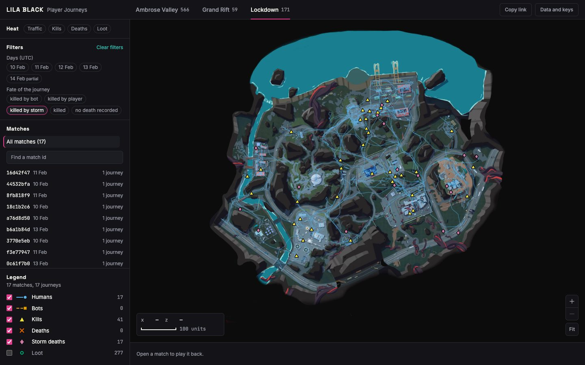
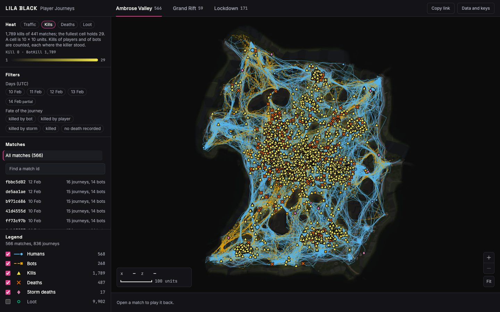
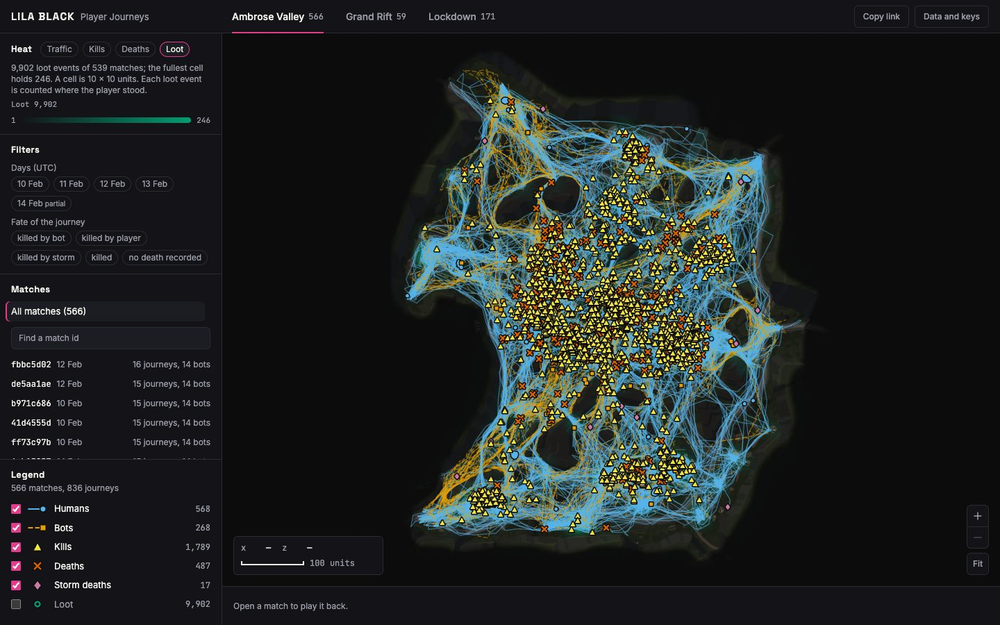
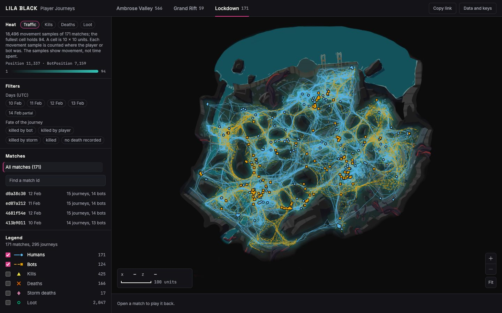

# Insights

Three things the tool showed about LILA BLACK. Every number below is printed by `make insights` (`analysis/insights.py`), which reads the same files the tool draws, and is held by a test (`pipeline/tests/test_insights.py`).

Read them with the data's limits in mind ([docs/DATA_NOTES.md](docs/DATA_NOTES.md)): five days of February 2026, 796 matches, 781 journeys of humans with an account id. Every kill in the data is a kill of a bot. A journey without a death is "no death recorded", which is not proof of an extraction. Numbers in threes are Ambrose Valley / Grand Rift / Lockdown.

## 1. On Lockdown the storm kills half of the players who stay late

**What caught my eye.** With the fate filter on "killed by storm", [Lockdown](https://lila-player-journeys-psi.vercel.app/?map=Lockdown&fate=killed_by_storm) shows as many storm deaths as [Ambrose Valley](https://lila-player-journeys-psi.vercel.app/?map=AmbroseValley&fate=killed_by_storm), with 171 matches against 566.

**Evidence.**

| | Ambrose Valley | Grand Rift | Lockdown |
|---|---|---|---|
| Journeys of humans with an account id | 554 | 57 | 170 |
| Storm deaths | 17 | 5 | 17 |
| as a share of those journeys | 3.1% | 8.8% | 10.0% |
| Journeys still recorded at 655 s (10:55), the earliest storm death in the data | 90 | 8 | 35 |
| of which die in the storm | 18.9% | 62.5% | 48.6% |
| of which record no death | 66 | 3 | 18 |
| Median seconds from a victim's last loot to the death | 75 | 96 | 132 |

The first storm death comes at 669 s, 683 s and 655 s on the three maps, so the storm arrives at about the same time everywhere. What differs is how many of the late players it catches. On Lockdown the victims had stopped looting a median of 132 s before they died, so they were not caught while looting; 7 died in the north-east quarter of the map and 5 in the south-east. Grand Rift points the same way, but 8 late journeys are too few to rest on.

**What to do, and what would move.** Shorten the way out on Lockdown's east side: an extraction point or a faster route there, or a slower last storm phase on this map. Watch storm deaths as a share of the journeys still recorded at 10:55 (48.6% now; Ambrose Valley's 18.9% is the reference), the share of late journeys that record no death, and the seconds from last loot to death. If that last number falls toward zero, players die greedy, and the fix is a warning, not a route.

**Why a Level Designer should care.** A storm death is the map beating the player: the exit was too far, or too hard to read, from where the loot kept people. On Lockdown that is every tenth journey.

## 2. Bots are fought where the loot is

**What caught my eye.** On Ambrose Valley, switching from the [Kills](https://lila-player-journeys-psi.vercel.app/?map=AmbroseValley&heat=kill) heat layer to the [Loot](https://lila-player-journeys-psi.vercel.app/?map=AmbroseValley&heat=loot) layer changes the colour and little else.

| Kills | Loot |
|---|---|
|  |  |

**Evidence.** A cell is 10 x 10 world units; "walked" cells are those a human's path crosses.

| | Ambrose Valley | Grand Rift | Lockdown |
|---|---|---|---|
| Kills by humans (all of bots) | 1,669 | 179 | 388 |
| Kills within one cell of a place where someone looted | 99.3% | 96.1% | 94.8% |
| Walked cells that are that close to loot | 66.7% | 58.8% | 56.7% |
| Cells that hold half of the loot | 68 | 36 | 70 |
| Kills in those cells or next to them | 45.0% | 48.0% | 36.1% |
| Walked cells that are those cells or next to them | 12.1% | 21.0% | 16.6% |
| Cells that hold half of the kills | 125 | 27 | 74 |
| as a share of the walked cells | 4.1% | 2.6% | 3.2% |
| Rank correlation of loot and kills per walked cell | 0.55 | 0.35 | 0.33 |

The fullest cell holds 29 kills, on Ambrose Valley at x 95, z −258: [zoom in on it](https://lila-player-journeys-psi.vercel.app/?map=AmbroseValley&heat=kill&view=1058,1559,4). Loot and bots may both follow the buildings; the data cannot say which leads.

**What to do, and what would move.** Treat loot placement as combat placement. To spread the fights, split the largest loot clusters: 68 cells hold half of Ambrose Valley's loot. To make a quiet area matter, put loot there before adding bots. Check whether bot patrols are anchored to loot rooms; if they are, a player who skips loot skips nearly all combat. Watch the share of kills within one cell of loot, kills per journey, and deaths to bots around the largest clusters.

**Why a Level Designer should care.** It names the lever that moves combat on these maps today. Sightlines and cover decide how a fight goes; in this data the loot decides where it happens.

## 3. Each map has a quiet quarter, with as little as half the traffic of its busiest one

**What caught my eye.** The Traffic layer on [Lockdown](https://lila-player-journeys-psi.vercel.app/?map=Lockdown&heat=movement&hide=kill,death,storm_death), with the markers hidden: the paths crowd the north-east and thin out toward the south-east. The same view of [Grand Rift](https://lila-player-journeys-psi.vercel.app/?map=GrandRift&heat=movement&hide=kill,death,storm_death) and of [Ambrose Valley](https://lila-player-journeys-psi.vercel.app/?map=AmbroseValley&heat=movement&hide=kill,death,storm_death).

**Evidence.** A cell counts as crossed when a path passes through it, also between two recorded positions.

| | Ambrose Valley | Grand Rift | Lockdown |
|---|---|---|---|
| Journeys | 836 | 111 | 295 |
| Cells that some journey crosses | 3,103 | 1,099 | 2,560 |
| Share of all crossings in the busiest tenth of those cells | 30.1% | 25.9% | 27.8% |
| Crossed cells that fewer than one journey in a hundred crosses | 27.9% | 9.3% | 19.1% |
| Busiest quarter, with its share of all crossings | SW 30.0% | NW 37.5% | NE 32.6% |
| Quietest quarter, with its share | NE 19.2% | SE 16.9% | SE 17.6% |

Two limits. The quarters are those of the minimap's artwork, and they do not hold equal land: Lockdown's north is partly sea. So they say where to look, not how much is wasted. And the share of cells that no journey ever crosses, 45.9% / 46.1% / 64.6% of the artwork's cells, is only an upper limit: it counts water, roofs, rocks and the corners of the artwork. A true figure needs the level's own map of walkable ground.

**What to do, and what would move.** Open the quiet quarter of each map in the tool first: Grand Rift's south-east, Lockdown's south-east, Ambrose Valley's north-east. Decide for each whether to give it a reason to visit (loot draws traffic and fights, as insight 2 shows), to connect it better, or to accept it as a buffer. Watch the share of crossings per quarter and the share of crossed cells under one journey in a hundred.

**Why a Level Designer should care.** Ground that players do not cross is built and not played. It also shrinks the map that the loot and the storm have to work with.
