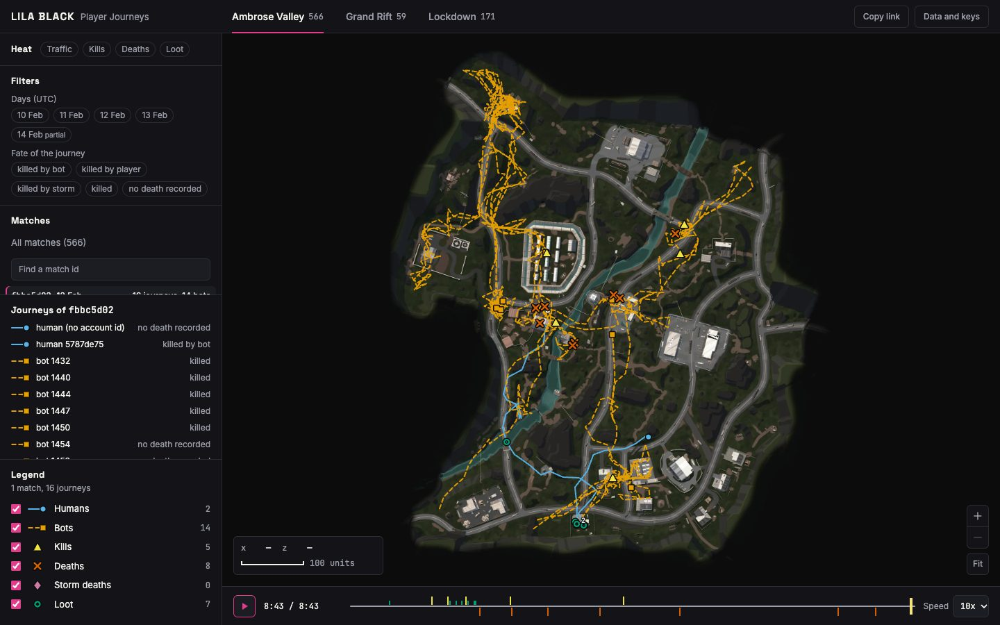
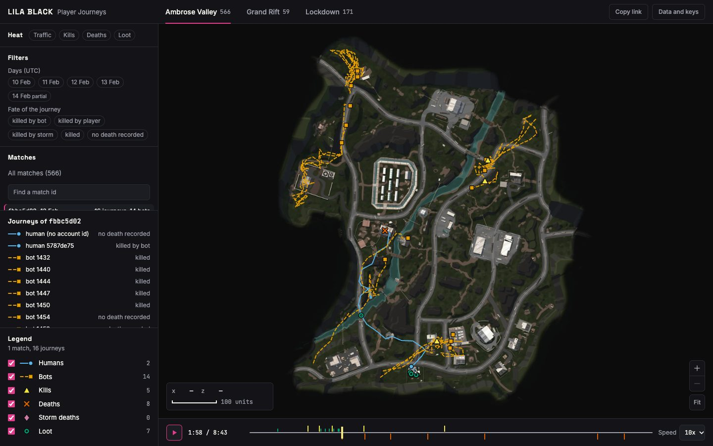
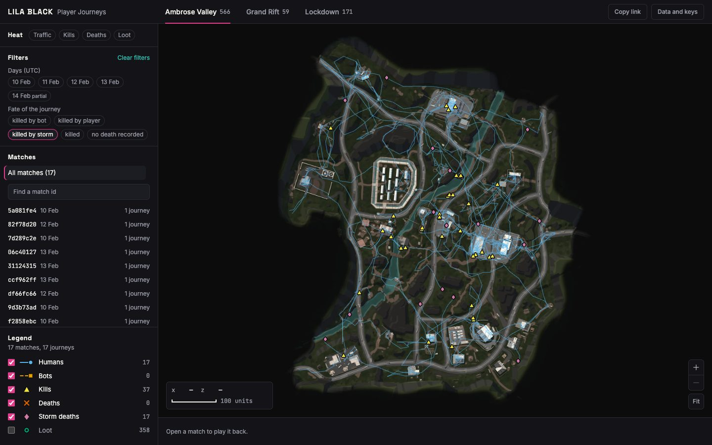
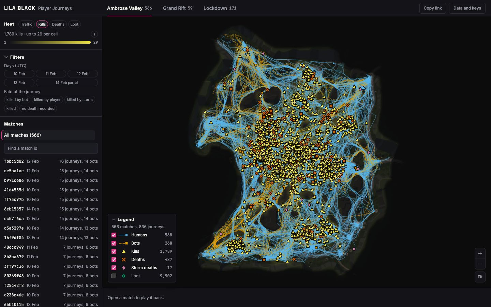

# LILA BLACK Player Journeys

**Live tool: https://lila-player-journeys-psi.vercel.app**

[](https://github.com/YesudasZ/lila-player-journeys/actions/workflows/ci.yml)

A browser tool for Level Designers to see how players move, fight, loot and die on LILA BLACK's three maps.
It draws every recorded journey on the game's minimaps, plays a match back on a timeline, and lays heat layers for traffic, kills, deaths and loot over the map.
Every view has its own address, so a finding can be sent as a link. Built for the LILA Games Product Engineer written test.

| Read this | To learn |
|---|---|
| [INSIGHTS.md](INSIGHTS.md) | three things the tool showed about the game, with the numbers behind them |
| [ARCHITECTURE.md](ARCHITECTURE.md) | one page: stack, data flow, coordinate mapping, assumptions, trade-offs |
| [docs/DATA_NOTES.md](docs/DATA_NOTES.md) | what the data really contains, where its README is wrong, and what the pipeline does about it |
| [docs/DATA_FORMAT.md](docs/DATA_FORMAT.md) | the files the app loads, field by field |
| [docs/BRIEF.md](docs/BRIEF.md) | the assignment as a checklist |

## Tech stack

- **App:** Vite, React, TypeScript (strict), Tailwind CSS v4 and Zustand, drawing on layered HTML canvases.
- **Data pipeline:** Python 3.12 or newer with pyarrow, pandas, numpy and Pillow. It runs offline and writes static files.
- **Hosting:** Vercel, static. **Env vars: none.**

## Run the app

Needs Node 22.12 or newer. It runs from the data files committed in `web/public/data/`, so nothing has to be downloaded.

```bash
cd web
npm ci && npm run dev    # http://localhost:5173
```

## Rebuild the data

Needs Python 3.12 or newer and the assignment's `player_data.zip`, which is not in this repo. Put the zip into `_inbox/`, then:

```bash
unzip _inbox/player_data.zip -d data/raw   # creates data/raw/player_data/
make data       # rebuild web/public/data/; writes nothing unless every check passes
make insights   # print the numbers behind INSIGHTS.md
```

`make profile` measures the raw data again (`docs/profile/`), and `make overlay` redraws the images that prove the coordinate mapping (`docs/img/`). `make help` lists every target.

## Tests

```bash
make test                  # pipeline, committed data and statistics; needs no raw data
cd web && npm run check    # type check, ESLint and unit tests
```

## Project structure

```
pipeline/    offline data code: read, check, clean, project, encode; its tests
analysis/    the statistics behind INSIGHTS.md
web/         the app: src/lib (pure logic with tests), src/state, src/components; public/data (generated, committed)
docs/        data notes and format, plan and progress, proof images, screenshots
```

## Walkthrough

Each step is a link into the live tool. A recording of the same steps: [docs/media/walkthrough.mp4](docs/media/walkthrough.mp4).

1. **[Every journey of a map](https://lila-player-journeys-psi.vercel.app/).** Humans are solid blue lines with round heads, bots dashed orange lines with square heads. Triangles are kills, crosses deaths, diamonds deaths in the storm. Drag to move, scroll to zoom; hover a path or a marker for who, when and where.

   

2. **[Filter by map and day](https://lila-player-journeys-psi.vercel.app/?map=Lockdown&days=February_10).** The tabs switch maps and show how many matches the filters leave on each. The chips filter by UTC day and by how a journey ended.

   

3. **[Open one match](https://lila-player-journeys-psi.vercel.app/?match=fbbc5d02).** Search for a match id or choose from the list. This one has 2 humans and 14 bots. Loot appears as small rings, and the sidebar lists the journeys.

   

4. **[Focus a journey](https://lila-player-journeys-psi.vercel.app/?match=fbbc5d02&journey=fbbc5d02-5787de75).** Click a path, or choose the journey from the list, to pick it out from the others.

   

5. **[Play the match back](https://lila-player-journeys-psi.vercel.app/?match=fbbc5d02&t=118).** Space plays and pauses; the slider and its keys seek; speeds go from 1x to 60x. The link opens at 1:58, the second in which a bot kills one of the two humans.

   

6. **[Filter by fate](https://lila-player-journeys-psi.vercel.app/?fate=killed_by_storm).** Only the journeys that ended in the storm, with their last positions.

   

7. **Heat layers:** [Traffic](https://lila-player-journeys-psi.vercel.app/?heat=movement), [Kills](https://lila-player-journeys-psi.vercel.app/?heat=kill), [Deaths](https://lila-player-journeys-psi.vercel.app/?map=Lockdown&heat=death) and [Loot](https://lila-player-journeys-psi.vercel.app/?heat=loot). The legend says what is counted, in how many matches, and at whose position. A layer follows every filter.

   

8. **[Zoom in and share](https://lila-player-journeys-psi.vercel.app/?heat=kill&view=1058,1559,4).** The address always says the view; "Copy link" copies it. The browser's Back and Forward step through the views you chose.

   

9. **Data and keys.** The button at the top right opens a short panel: where the data differs from its README, what each heat layer counts, and the keys.

## How it was built

AI tools were used throughout: the project was built with Claude Code. `CLAUDE.md`, `docs/PLAN.md` and `docs/PROGRESS.md` show how the work was planned, checked and recorded phase by phase. The numbers in the docs come from scripts in this repo: `make profile` for the raw data and `make insights` for the insights.
